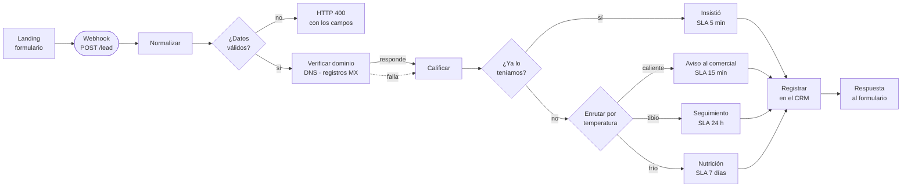

# Captación y calificación de prospectos — landing + n8n + CRM

Demo técnica de un embudo completo: una **landing page** captura el prospecto, un **workflow de
n8n** lo valida, lo enriquece, lo califica y lo enruta, y lo deja registrado en el **CRM**.

Es el recorrido que hace cualquier agencia cuando conecta un formulario con un CRM, montado de
punta a punta y con las decisiones explicadas. Todo lo que hay aquí se puede ejecutar sin pagar
nada y sin credenciales de ningún servicio.



## Qué demuestra

| | |
|---|---|
| **Landing page** | Página de captación con formulario, validación en el navegador y estados de error visibles |
| **Funnel** | Calificación automática por presupuesto, urgencia y tipo de correo, con tres rutas y su SLA |
| **Automatización** | 14 nodos en n8n: validación, bifurcaciones, llamada a API externa, manejo de error y respuesta |
| **Integración** | Webhook de entrada, API externa de verificación y escritura en el CRM |
| **Criterio** | Validación también del lado del servidor, anti-duplicados con ventana y el error que no pierde el prospecto |

## Cómo probarlo

1. **Levanta n8n** (Docker):
   ```bash
   docker run -it --rm -p 5678:5678 -v n8n_demo:/home/node/.n8n n8nio/n8n
   ```
2. **Importa el flujo**: en n8n, *Workflows → Import from File* → `n8n/flujo-captacion.json`.
   Actívalo con el interruptor de arriba a la derecha.
3. **Pruébalo sin la landing**:
   ```bash
   ./n8n/probar.sh
   ```
   Son ocho casos: los tres caminos de calificación, dos rechazos, el duplicado, el dominio que no
   recibe correo y una entrada que no viene del formulario.
4. **O con la landing**: copia la *Production URL* del nodo Webhook, pégala en `index.html` en la
   constante `WEBHOOK`, y abre la página. Sirve abriendo el archivo directamente, sin montar un
   servidor: n8n contesta el *preflight* y devuelve `Access-Control-Allow-Origin` con el origen que
   recibe, incluido el `null` de un `file://`.

## Decisiones que vale la pena mirar

**La validación está en los dos lados.** El formulario valida para que el usuario tenga respuesta
inmediata, y el flujo valida otra vez porque el webhook es una dirección pública: cualquiera puede
llamarlo con `curl` sin pasar por la página. Confiar en la validación del navegador es confiar en
el cliente.

**El error no pierde el prospecto.** El nodo que verifica el dominio tiene la salida de error
conectada al mismo sitio que la salida buena. Si ese servicio no responde, el lead se guarda igual,
marcado como no verificado. Perder un cliente porque falló un servicio secundario es peor que
guardarlo incompleto.

**Un tope, no una resta.** Si el dominio del correo comprobadamente no recibe correo, el prospecto
no puede pasar de tibio. Al principio era una resta de puntos y no servía: un presupuesto alto la
compensaba y el lead salía caliente igual. No se manda a un comercial a perseguir a alguien a quien
no le vamos a poder escribir.

**Quien insiste no se duplica: sube de prioridad.** La gente reenvía el formulario cuando no ve
respuesta rápido. El flujo lo reconoce por correo dentro de una ventana de 24 horas y actualiza en
vez de crear otra ficha. Pasadas esas horas ya no es insistencia, es una oportunidad nueva.

**La calificación explica por qué.** Cada prospecto viaja con el detalle del puntaje
(`"presupuesto mas_1500: +40"`, `"correo corporativo: +20"`). Un comercial tiene que poder discutir
por qué un lead quedó frío, y eso no se puede hacer con una caja negra.

**Ninguna credencial en el repositorio.** El nodo que escribe en el CRM toma la clave de una
variable de entorno y viene desactivado, para que la demo corra sin nada configurado.

## Estructura

```
index.html                  La landing con el formulario
n8n/flujo-captacion.json    El workflow exportado, listo para importar
n8n/README.md               Qué hace cada nodo y por qué está ahí
n8n/probar.sh               Los ocho casos de prueba contra el webhook
```

**[→ La explicación nodo por nodo está en `n8n/README.md`](n8n/README.md)**, con el detalle del
puntaje y lo que faltaría para llevarlo a producción.

## Lo que NO está aquí

Esto es una demostración construida para mostrar el método. Mi trabajo principal es una plataforma
CRM con asistentes conversacionales de WhatsApp y Telegram que mantengo en producción, de mi
propiedad, y de la que no publico el código. Puedo recorrerla en vivo compartiendo pantalla.
