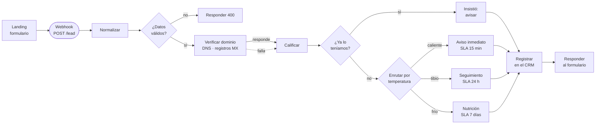

# El flujo, nodo por nodo

`flujo-captacion.json` se importa en n8n con *Workflows → Import from File*. Son catorce nodos.
Esta página explica qué hace cada uno y, sobre todo, por qué está ahí: casi cualquiera puede
conectar un formulario con un CRM, y lo que separa un flujo que aguanta de uno que no son estas
decisiones.



## Entrada

**1 · Webhook** — `POST /lead`. Está en modo *Using Respond to Webhook node*: no contesta al
recibir, contesta al final. Así la respuesta que ve el visitante lleva el resultado real de su
calificación y no un "recibido" vacío.

**2 · Normalizar** *(Code)* — deja el prospecto en una forma estable: correo en minúsculas,
teléfono solo con dígitos y sin el `57` del país, presupuesto convertido a rango. El teléfono se
limpia por una razón concreta: si el CRM guarda `300 123 4567`, `+573001234567` y `3001234567`
como tres textos distintos, nunca va a detectar que son el mismo cliente.

También acepta el presupuesto como número suelto (`"USD 1.800"`), porque el webhook no lo llama
solo la landing: mañana lo llama un formulario de Meta Ads que manda otra cosa.

**3 · ¿Datos válidos?** *(IF)* — el navegador ya validó, pero esta dirección es pública: cualquiera
puede llamarla con `curl` sin pasar por la página. Lo que viene de afuera no se cree. Si falta
algo, el flujo se corta aquí.

**4 · Rechazar** *(Respond to Webhook)* — devuelve `400` con la lista de campos que fallaron, para
que el formulario pueda marcarlos en rojo en vez de decir "algo salió mal".

## Enriquecimiento

**5 · Verificar dominio** *(HTTP Request)* — consulta a `dns.google` si el dominio del correo tiene
registros MX, es decir, si puede recibir correo. Es gratis, no necesita credenciales y atrapa el
caso más común: el correo mal escrito.

El nodo tiene **salida de error activada** y esa salida roja vuelve al mismo sitio que la verde.
Si el DNS no responde, el prospecto se guarda igual, marcado como *no verificado*. Perder un
cliente porque falló un servicio secundario es peor que guardarlo incompleto.

## Decisión

**6 · Calificar** *(Code)* — suma puntos y devuelve también el **porqué**:

| Señal | Puntos |
|---|---|
| Presupuesto más de USD 1.500 | +40 |
| Presupuesto USD 500 – 1.500 | +25 |
| Presupuesto menos de USD 500 | +10 |
| Lo necesita ya | +30 |
| Lo necesita este mes | +20 |
| Correo corporativo (no Gmail/Hotmail/…) | +20 |

De 65 para arriba es **caliente**, de 35 **tibio**, debajo **frío**.

Hay una regla que no es una suma: **si el dominio comprobadamente no recibe correo, el prospecto
no puede pasar de tibio**. Empezó siendo una resta de 15 puntos y no servía — un presupuesto alto
la compensaba y el lead salía caliente igual. Un tope es más honesto: no se manda a un comercial a
perseguir a alguien a quien no le vamos a poder escribir.

El campo `porque` viaja con el prospecto hasta el CRM. Un comercial tiene que poder discutir por
qué un lead quedó frío, y eso no se puede hacer con una caja negra.

**7 · ¿Ya lo teníamos?** *(IF)* — la gente envía el formulario dos veces cuando no ve respuesta
rápido. El flujo lo detecta por correo y, en vez de crear otra ficha, **sube la prioridad**: quien
insiste está comprando. Usa los datos estáticos del workflow (`$getWorkflowStaticData`), que n8n
conserva entre ejecuciones.

Solo cuenta como repetido dentro de una **ventana de 24 horas**. Quien escribió hace tres meses no
está insistiendo: es una oportunidad nueva, y tratarla como duplicado la manda a actualizar un
registro viejo en vez de abrir el ciclo otra vez. La memoria además se limpia sola, para que no
crezca sin fin.

En producción esto lo resuelve el CRM con una restricción única sobre el correo; aquí alcanza para
dejar demostrado que el caso está contemplado.

## Salida

**8–11 · Las cuatro rutas** *(Set)* — cada una fija la acción, el SLA en minutos, una nota para el
equipo y el mensaje que verá el visitante:

| Ruta | Acción | SLA |
|---|---|---|
| Insistió | actualizar y avisar | 5 min |
| Caliente | avisar al comercial | 15 min |
| Tibio | secuencia de seguimiento | 24 h |
| Frío | lista de nutrición | 7 días |

El SLA viaja como dato, no como texto en una nota: así el CRM puede alertar solo cuando se venza.

**12 · Registrar en el CRM** *(HTTP Request)* — **viene desactivado** para que la demo corra sin
credenciales. La clave sale de `$env.CRM_API_KEY`: nunca del repositorio. Para conectarlo de
verdad basta con activarlo y poner la URL.

**13 · Responder al formulario** *(Respond to Webhook)* — devuelve la temperatura, los puntos, el
porqué y el mensaje. La landing muestra ese mensaje tal cual.

## Probarlo sin la landing

Con el flujo importado y activo:

```bash
# Caliente: empresa, presupuesto alto, lo necesita ya
curl -X POST http://localhost:5678/webhook/lead \
  -H 'Content-Type: application/json' \
  -d '{"nombre":"Laura Restrepo","email":"laura@clinicasanrafael.com",
       "telefono":"300 123 4567","presupuesto":"mas_1500","urgencia":"ya"}'

# Frío: poco presupuesto y solo mirando
curl -X POST http://localhost:5678/webhook/lead \
  -H 'Content-Type: application/json' \
  -d '{"nombre":"Ana Gil","email":"anagil@hotmail.com",
       "telefono":"3205551122","presupuesto":"menos_500","urgencia":"explorando"}'

# Rechazado: faltan datos
curl -X POST http://localhost:5678/webhook/lead \
  -H 'Content-Type: application/json' \
  -d '{"nombre":"X","email":"no-es-correo","telefono":"123"}'
```

El script **`probar.sh`** corre esos y cinco más — los ocho casos que importan — y dice cuántos
fallaron:

```
$ ./probar.sh http://localhost:5678/webhook/lead

  ok   Caliente: empresa, presupuesto alto, lo necesita ya  HTTP 200
  ok   Tibio: correo gratuito, presupuesto medio, este mes  HTTP 200
  ok   Frío: poco presupuesto, solo explorando              HTTP 200
  ok   Rechazo: correo mal escrito y teléfono corto         HTTP 400
  ok   Rechazo: cuerpo vacío                                HTTP 400
  ok   Duplicado: el mismo correo sube de prioridad         HTTP 200
  ok   Dominio sin correo: no puede pasar de tibio          HTTP 200
  ok   Otro origen: presupuesto como número suelto          HTTP 200

8 casos · 0 fallidos
```

Cada corrida usa correos con marca de tiempo, así que se puede correr las veces que haga falta sin
que la ventana anti-duplicados ensucie el resultado.

## Lo que falta para producción

No se cuela como si estuviera resuelto:

- **Autenticación en el webhook** (cabecera compartida o HMAC). Hoy la dirección es pública.
- **Límite de peticiones**: nada impide que alguien mande mil formularios.
- **Cola** para el registro en el CRM, con reintentos, en vez de llamar en línea.
- **El anti-duplicados real** va en el CRM, con una restricción única sobre el correo.
